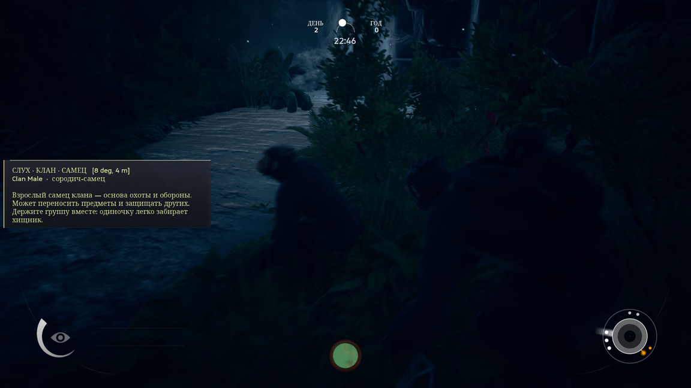

# Ancestors Codex

Энциклопедия для **Ancestors: The Humankind Odyssey** (PC, UE 4.20): подсказка с описанием существа
прямо на экране, когда вы смотрите на него в режиме чувств.



## Что делает

- Смотрит, на кого направлена камера (конус 25°, до 30 м), и показывает карточку: категория,
  английское и русское название, 2–4 строки описания.
- Карточка прижата к левому краю экрана, высота подстраивается под текст, фон — игровая текстура HUD,
  иконка вида — настоящая иконка слуха из игры.
- База: **38 животных**, **21 предмет**, **5 записей клана** — EN + RU. Всё в `Scripts/codex_data.lua`,
  правится без пересборки мода.
- Работает в одиночной игре. Мультиплеера в игре нет.

## Требования

- Ancestors: The Humankind Odyssey, сборка 1.0 (UE 4.20), Windows.
- [UE4SS](https://github.com/UE4SS-RE/RE-UE4SS) **experimental 3.0.1-1181** (или новее из ветки experimental).
  Проверено именно на этой версии.

## Установка

1. Поставьте UE4SS в папку игры, рядом с exe:
   ```
   Ancestors\Binaries\Win64\dwmapi.dll
   Ancestors\Binaries\Win64\ue4ss\
   ```
2. Скопируйте папку `AncestorsCodex` в `Ancestors\Binaries\Win64\ue4ss\Mods\`:
   ```
   ...\ue4ss\Mods\AncestorsCodex\Scripts\main.lua
   ...\ue4ss\Mods\AncestorsCodex\Scripts\codex_data.lua
   ```
3. Включите мод — одна строка в `...\ue4ss\Mods\mods.txt` (порядок строк = порядок загрузки):
   ```
   AncestorsCodex : 1
   ```
4. В `...\ue4ss\UE4SS-settings.ini` должно быть:
   ```ini
   ; иначе возможен краш при переходе из меню в игру (TickWorldTravel)
   HookLoadMap = 0
   HookBeginPlay = 0
   HookEndPlay = 0
   HookInitGameState = 0
   ```
5. Запустите игру, дойдите до игрового уровня.

## Клавиши

| Клавиша | Что делает |
|---|---|
| **F2** | гейт «только в режиме чувств» (по умолчанию включён) |
| **F3** | показать карточку ближайшего существа (для проверки) |
| **F4** | скрыть карточку |
| **F5** | показать/скрыть дебаг-строку `[8 deg, 4 m]` |
| **F6** | проиграть игровую UMG-анимацию виджета (эксперимент) |
| **F7** | дамп состояния прицела в `Mods\AncestorsCodex\dump.txt` |
| **F8** | включить/выключить карточку |
| **F9** | полный дамп сцены (классы персонажей, камера) |

Клавиши мода работают **только когда окно игры в фокусе** и **только в загруженном уровне**
(на сплэше мод сам отказывается что-либо делать — это защита от краша).

## Настройка

Константы в начале `Scripts/main.lua`:

```lua
local AIM_ANGLE = 25.0     -- конус наведения, градусы
local AIM_DIST  = 3000     -- дистанция, юниты (3000 = 30 м)
local X_PLATE, W_PLATE = -96, 640   -- геометрия карточки (отрицательный x = компенсация инсета виджета)
local SCALE_BODY = 1.0      -- масштаб текста
local DEBUG_TEXT = true     -- дебаг-строка в заголовке
local SENSE_ONLY = true     -- показывать только в режиме чувств
```

> `UTextBlock:SetFont` в этой сборке игры **роняет игру** — размер меняется только `SetRenderScale`,
> то есть `SCALE_BODY`. Учтите, что масштаб влияет и на вёрстку.

## Свои описания

`Scripts/codex_data.lua` возвращает таблицу `{ animals = {...}, items = {...}, clan = {...} }`.
Одна запись:

```lua
{ keys = { "machairodus" }, cat = "ХИЩНИК · САБЛЕЗУБ", en = "Machairodus", ru = "махайрод",
  body = "Строка 1\nСтрока 2" },
```

`keys` — подстроки имени класса актора в нижнем регистре (`BP_Crawler_GreenMamba_Character_C` → `greenmamba`).
`cat` идёт в заголовок, `en` и `ru` — во вторую строку, `body` — сам текст.
После правки файла достаточно нажать в игре **Ctrl+R** (хот-релоад модов UE4SS), перезапуск не нужен.

## Известные ограничения

- **Предметы в мире пока не опознаются**: в игре они не `Character`, поиск по акторам ещё не сделан.
  Записи предметов уже в базе — заработают, когда добавим их поиск.
- **Иконка есть только у животных** — для клана в игре иконок нет.
- Гейт «только в режиме чувств» опирается на сенсорные акторы игры (`BP_SenseIconActor_C` /
  `BP_FocusIconActor_C`). Если карточка в чувствах не появляется — нажмите **F2** (гейт выключится).
- Названия и описания — авторские, по мотивам игры и вики; это не официальный текст Panache Digital.

## Если что-то пошло не так

- Лог: `Ancestors\Binaries\Win64\ue4ss\UE4SS.log` (он обрезается примерно на 72 КБ, смотрите хвост).
- Дампы мода: `Mods\AncestorsCodex\dump.txt`.
- Краши UE4SS пишет в `ue4ss\crash_*.dmp`.
- **Не нажимайте клавиши мода на сплэше/экране загрузки** — создание виджета в этот момент роняет игру.
- Уберите мод: удалите папку `Mods\AncestorsCodex` и строку из `mods.txt`.

## Совместимость

- Одиночная игра. Сохранения мод не трогает, файлы игры не изменяет — только добавляет папку в `ue4ss\Mods`.
- Другие Lua-моды UE4SS конфликтов не вызывали, но всё, что тоже лезет в HUD/виджеты, может спорить за экран.

## Благодарности и лицензия

- **UE4SS** (RE-UE4SS, experimental) — загрузчик Lua для UE4.
- Идея и реверс-инжиниринг ассетов игры: repak, UAssetAPI/UAssetGUI (для дампов дататейблов).
- Код мода — **MIT**, делайте что хотите. Тексты описаний — CC BY 4.0.
- В моде **нет файлов игры**: ни ассетов, ни распакованного контента. Текстуры и иконки берутся из
  установленной игры в рантайме по путям `/Game/...` и не распространяются.
- Сделано агентом (DeepSeek Harness, модель deepseek-flash) совместно с человеком; описывайте так же честно,
  если будете перепубликовывать.

## Changelog

**0.1.0**
- Первый рабочий релиз: карточка существ/клана по наведению, компактная плита у левого края,
  база 38 животных / 21 предмет / 5 записей клана (EN+RU), дебаг-клавиши.
- Известно: предметы в мире не опознаются; анимация виджета выключена по умолчанию.
